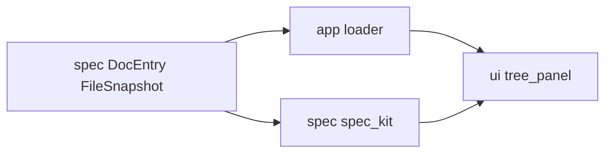

# 설계서 - spec-viewer-doc-modified-date

## 정의
스펙 문서의 진행 상태를 트리에서 훑어보는 spec-viewer 사용자를 위해, 문서 행의 상태 기호 옆에 그 문서 파일의 최종 수정일을 흐리게 보여 주는 기능을 기존 트리 구성 경로에 얹는 설계이다.

## 경계 확정

### 소유 범위 (이 스펙)
- **문서 수정 시각 수집**: `.kiro` 스냅숏 읽기 시점과 spec-kit 기능 조립 시점에 문서 파일의 수정 시각을 한 번 읽어 문서 항목에 싣는다. 렌더 중에는 디스크를 읽지 않는다.
- **날짜와 시각 문자열 만들기**: 수정 시각을 로컬 `YYYY-MM-DD`와 `YYYY-MM-DD HH:MM:SS`로 바꾸는 함수(기존 `format_modified`에서 파생).
- **시각 표시 여부 결정**: 문서 행마다 시각까지 붙인 너비가 패널 안에 들어갈 때만 시각을 붙인다.
- **문서 행 날짜 표시**: 스펙 아래 문서 행의 끝에 흐린 날짜 구간을 덧붙인다.

### 비소유 범위
- **스펙 행, `--all` 트리, `.kiro` 하위 그룹 트리의 표시**: 기존 트리 패널 코드가 그대로 소유하고, 이 스펙은 바꾸지 않는다.
- **정렬 키 `updated`의 기준**: `spec.json`의 `updated_at`이며 기존 정렬 스펙이 소유한다.
- **파일 감시와 재스캔 시점**: `watch`와 `resync`가 소유하며 이 스펙은 호출 시점을 바꾸지 않는다.
- **문서 패널 상태 표시줄의 수정일시**: 문서 로드 경로(`load_doc`)가 소유한다.

### 허용 의존
- External: 없음(표준 라이브러리의 파일 메타데이터만 사용, 새 의존성 없음).
- Internal direction: `spec`(타입) -> `app::loader`(읽기, 날짜 문자열) -> `ui::tree_panel`(표시). 역방향 import는 설계 위반이다. `spec::spec_kit`은 `spec`의 타입만 쓰고 직접 파일 메타데이터를 읽는다.

### 재검증 조건
- 문서 항목(`DocEntry`)이나 파일 스냅숏(`FileSnapshot`)의 필드 계약이 바뀔 때.
- 트리 항목 빌드가 렌더 중 디스크를 읽도록 바뀔 때(수정 시각 수집 위치 가정이 깨짐).
- 트리 패널 폭이 줄어 날짜가 문서명을 가리는 구성이 생길 때(표시 위치 가정).

## 아키텍처

### 경계 맵


### 기술 스택
| 계층 | 선택 기술 | 역할 |
|-------|--------|------|
| 도메인 타입 | Rust 표준 `SystemTime` | 수정 시각 보관 |
| 읽기 | Rust 표준 파일 메타데이터 | 스냅숏 읽기와 spec-kit 조립 시 1회 조회 |
| 표시 | ratatui 0.30 | 흐린 스타일 구간 |

### 핵심 결정
- **수정 시각은 도메인 항목에 보관하고 렌더에서 읽지 않는다**: 렌더가 매 프레임 호출되므로 디스크 접근을 피한다 - reason: 큰 트리에서 프레임 지연 방지. 대안(렌더 중 조회)은 research.md 없이 기각.
- **날짜 문자열은 기존 `format_modified`의 앞 10자로 만든다**: 로컬 시간대 변환을 한 곳에 둔다 - reason: SSoT.
- **읽을 수 없는 시각은 `None`으로 두고 표시를 생략한다**: 오류를 올리지 않는다 - reason: 1.4.
- **시각은 행이 패널에 들어갈 때만 붙인다**: 행마다 문서명, 진행률, 날짜, 시각의 너비를 합산해 판단한다 - reason: 고정 폭 기준은 140열 화면(트리 42칸)에서도 시각이 거의 안 보였다(1.9). 부분 잘림은 보기 흉해 기각.
- **날짜 구간은 행 끝에 둔다**: 파일명, 진행률 뒤에 두 칸 간격으로 붙인다 - reason: 1.1, 1.5 순서 보장.

## 요구사항 추적
| 요구사항 ID | 구현 요소 |
|---|---|
| 1.1, 1.2, 1.3, 1.4 | 문서 수정 시각 수집, 문서 행 날짜 표시 |
| 1.5, 1.6, 1.7, 1.8, 1.9 | 문서 행 날짜 표시, 시각 표시 여부 결정 |
| 2.1, 2.2 | 문서 수정 시각 수집(재스캔 때 다시 읽음) |
| 3.1, 3.2, 3.3 | 문서 행 날짜 표시(문서 행만 변경, 일치 강조 적용), 수집은 읽기 전용 |

## 컴포넌트와 인터페이스

### spec - 문서 항목 타입
- 의도: 문서 수정 시각을 담는 자리를 제공한다.
- 요구사항: 1.1~1.4, 2.1, 2.2
```rust
pub struct FileSnapshot { pub name: String, pub path: PathBuf, pub content: String, pub modified: Option<SystemTime> }
pub struct DocEntry { pub kind: DocKind, pub path: PathBuf, pub exists: bool, pub status: DocStatus,
                      pub progress: Option<Progress>, pub modified: Option<SystemTime> }
```
- 파일이 없는 슬롯은 `modified: None`. `build()`는 스냅숏의 `modified`를 해당 문서 항목에 그대로 옮긴다.

### app::loader - 수정 시각 수집과 날짜 문자열
- 의도: 스냅숏을 읽을 때 각 파일의 수정 시각을 담고, 날짜와 시각 문자열 함수를 제공한다.
- 요구사항: 1.1, 1.4, 1.6, 1.8, 2.1
```rust
pub fn format_modified_date(modified: SystemTime) -> String;      // "YYYY-MM-DD", local time
pub fn format_modified_timestamp(modified: SystemTime) -> String; // "YYYY-MM-DD HH:MM:SS", local time
```
- 초는 UTC 초와 같다(시간대 오프셋이 분의 정수배라는 전제).
- 메타데이터 읽기 실패는 `None`으로 접는다(오류 없음).

### spec::spec_kit - spec-kit 문서 수정 시각
- 의도: spec-kit 문서 항목(표준 문서, `tasks.md`, `contracts/`, 그 밖의 파일)에도 수정 시각을 싣는다.
- 요구사항: 1.2, 1.4, 2.1
```rust
fn modified_of(path: &Path) -> Option<SystemTime>;
```

### ui::tree_panel - 문서 행 날짜 표시
- 의도: 문서 행 끝에 흐린 날짜 구간을 덧붙이고, 검색 일치 강조를 적용한다.
- 요구사항: 1.1~1.9, 3.1, 3.2
- 요약: 시각까지 붙인 행 너비(들여쓰기와 표시 기호 4칸 포함)가 패널 안쪽 폭 이하면 `"  YYYY-MM-DD HH:MM:SS"`, 아니면 `"  YYYY-MM-DD"` 구간을 진행률 구간 뒤에 추가, 기본 스타일에 흐림 효과를 더한다. 스펙 행과 파일 트리 행 생성 경로는 건드리지 않는다.

## 데이터 모델
위 인터페이스 블록이 전부다. 새 영속 데이터는 없다.

## 오류 처리
- **사용자 입력 오류**: 해당 없음.
- **외부 자원 오류**: 수정 시각을 못 읽으면 날짜만 생략하고 행은 그대로(1.4). 문서가 없으면 미생성 표시(1.3, 2.2).
- **시스템 오류**: 로컬 시간 변환 실패 시 기존 `format_modified`의 UTC 대체 변환을 따른다.
- **기능 강등**: 날짜가 없는 행은 이 기능 이전 표시와 같다.

## 테스트 전략
- **깊이**: Standard - 표시 규칙과 두 소스에 걸친 수집이 있으나 도메인 규칙은 단순하다.
- **단위**: `format_modified_date`가 `format_modified`의 날짜 부분과 같음(1.6). 문서 행에 날짜가 파일명 뒤에 나오고 `None`이면 나오지 않음(1.1, 1.3, 1.4, 1.5). 일치 강조가 날짜에도 적용(3.2).
- **통합**: 실제 파일을 읽은 스냅숏의 모든 파일이 수정 시각을 가짐(1.1, 2.1). spec-kit 조립이 수정 시각을 채움(1.2).
- **E2E**: `.kiro` 스펙을 펼친 화면에 문서 행 날짜가 보임. 파일을 수정하고 새로고침하면 날짜 갱신, 삭제하면 사라짐(2.1, 2.2).
- **인수**: 1.1~3.3 충족과 실제 실행 확인.
- **성능**: 렌더 경로에 디스크 접근이 없음을 코드 구조로 확인한다(수치 목표 없음).
- **속성 기반**: P1: 임의의 수정 시각에 대해 날짜 문자열은 10자 `YYYY-MM-DD` 형태다 - 1.6 - 0 이상 정수 초. P2: 스펙 행, `--all` 트리, 하위 그룹 트리의 렌더 결과는 변경 전과 같다 - 3.1 - 기존 트리 테스트 전체. 스티어링에 속성 기반 테스트 라이브러리 지정이 없어 P1은 대표 값 예시(에포크, 윤년 경계, 현재)로, P2는 기존 회귀 테스트로 검증한다.

## 파일 구조 계획
```
src/spec/mod.rs         code  FileSnapshot.modified, DocEntry.modified, build()가 값을 옮김
src/spec/spec_kit.rs    code  modified_of, spec-kit 문서 항목에 수정 시각
src/spec/sort.rs        code  (테스트 픽스처의 DocEntry 필드 보충만)
src/app/loader.rs       code  스냅숏 읽기 시 수정 시각, format_modified_date + 테스트
src/ui/tree_panel.rs    code  doc_item 날짜 구간 + 표시 테스트
```
