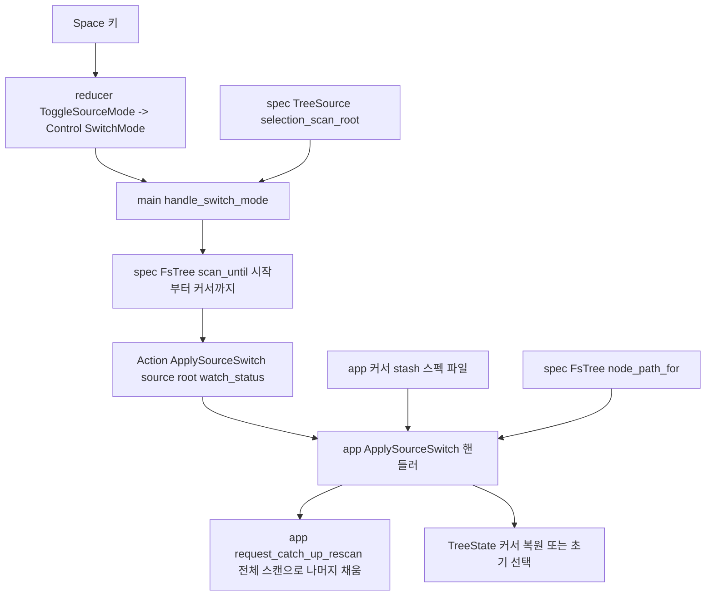
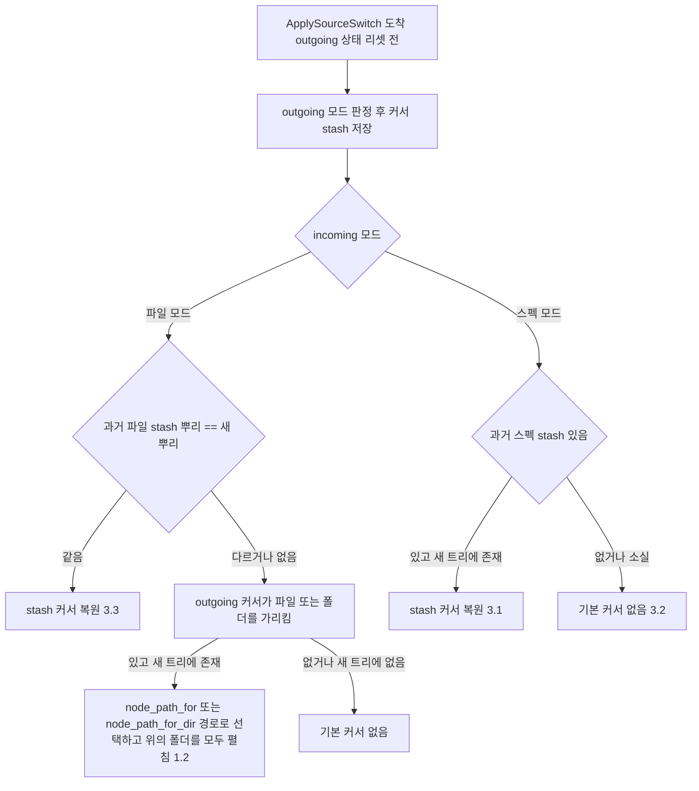

# 설계서 - spec-viewer-files-mode-cursor-scan

## 정의
spec-viewer 사용자를 위해 모드 전환 시 시작부터 커서까지를 먼저 그려 즉시 파일 모드로 들어가고 나머지는 이어서 채우고, 왕복할 때 각 모드의 커서를 복원하며, CLI 플래그 `--all`을 `--files`로 교체하고 모드 전환 핫키를 vi 관례와 충돌하지 않는 Space로 옮기는 변경의 기술 설계이다.

## 경계 확정

### 소유 범위 (이 스펙)
- **CLI 플래그 교체**: `--all` 제거, `--files` 도입 - 파싱, 시작 오류, 도움말, README 문서 전부(`src/main.rs`, `README.md`).
- **전환 시 첫 화면 구성**: `NodeId` 선택 경로를 디스크 디렉터리로 매핑하는 순수 함수와, 시작부터 커서까지만 읽는 `FsTree::scan_until`로 첫 화면을 만들고 이어서 전체 재스캔을 요청하는 배선(`src/spec/mod.rs`, `src/spec/fs_tree.rs`, `src/main.rs`).
- **모드별 커서 보존**: 전환 성공 시 outgoing 커서를 stash에 저장하고 incoming 커서를 복원/초기 선택하는 리듀서 로직과 상태 필드(`src/app/mod.rs`).
- **커서 지정 파일·폴더의 트리 경로 계산과 펼침**: 파일 모드 새 트리 안에서 선택할 `NodeId` 경로를 만드는 순수 함수(`node_path_for`, `node_path_for_dir`, `src/spec/fs_tree.rs`)와, 선택 후 커서 위의 폴더를 모두 열고 폴더 커서는 그 폴더도 여는 `select_cursor_in_files_tree`(`src/app/mod.rs`).
- **소유 biz-process 파일 갱신**: 승인된 append 사양(L2-A1/A7 변경, L2-A8 신규, BR-SPEC-VIEW-001~010)을 `.kiro/specs/spec-viewer/biz-process.md`에 반영.
- **핫키 교체와 용어 통일**: 모드 전환 바인딩을 `m`에서 Space로 옮기고 `m`을 미바인딩으로 해제하며, 앱 안 "전체 모드" 문구를 "파일 모드"로(`src/app/keymap.rs`). `spec-viewer-tree-navigation-modes` 1.6의 전환 시 트리 초기화는 왕복 커서 복원으로 대체한다(문서 패널 초기화인 그 스펙의 1.7은 유지).

### 비소유 범위
- **스펙 모드 트리의 로딩/구조**: `spec::build`/`load_snapshot`은 이 스펙이 건드리지 않는다 - 기존 `spec-viewer` 스펙 소유.
- **파일 모드의 정렬 규칙**: `FsTree::sort_entries`/`SortKey::for_files` - `spec-viewer-files-mode-sort` 소유. 이 스펙은 전환 시 기존 정렬 적용 절차를 그대로 재사용할 뿐이다.
- **파일 모드의 스캔 알고리즘 자체**: 깊이 상한(6), 숨김/`.gitignore` 규칙은 `FsTree::scan`이 그대로 소유한다 - 이 스펙은 뿌리와 첫 화면 범위를 바꾼다.
- **watch 재시작 메커니즘**: `watch::start`/`Watch` 구조 - 기존 watch 설계 소유. 이 스펙은 새 뿌리를 전달하기만 한다.
- **spec-kit 탐지 규칙**: `resolve_spec_mode`의 판정 순서 - `spec-viewer-spec-kit-support` 소유.

### 허용 의존
- 외부: 신규 없음. `clap` 4(기존, 플래그 파싱), `tui-tree-widget` 0.24(기존, `TreeState`)만 사용.
- 내부 의존 방향: `spec`(도메인 최하층: `selection_scan_root`, `node_path_for`, `node_path_for_dir`, `scan_until`) -> `app`(배선: stash/복원) -> `ui`(표시). `main`은 `spec`/`app` 양쪽을 씀(기존 그대로). 역방향 import는 설계 위반.

### 재검증 조건
- `NodeId` 식별자 체계가 바뀌면(예: `File` 노드가 경로 외 키를 담게 되면) `selection_scan_root`/`node_path_for`/`node_path_for_dir`의 매핑 규칙을 다시 짜야 한다.
- 모드가 3개 이상으로 늘면 stash가 모드별 맵으로 일반화되어야 한다(지금은 스펙/파일 2개짜리 고정 필드).
- `FsTree::scan`의 무시 규칙이 바뀌면 "커서가 가리키는 파일은 항상 새 트리에 존재한다"는 1.2 힌트의 전제를 다시 확인해야 한다.
- `ApplySourceSwitch`가 모드 전환 외의 경로에서도 쓰이게 되면 stash 저장 시점(전환 성공 시)을 재검토해야 한다.

## 아키텍처

### 경계 맵


### 기술 스택
| 계층 | 선택 기술 | 역할 |
|-------|--------|------|
| 커서 상태 저장 | 기존 `tui-tree-widget` `TreeState` | 선택/펼침. stash는 `Vec<NodeId>`만 보관 |
| 스캔 | 기존 `ignore::WalkBuilder` | 전달받은 뿌리 아래만 걷는 기존 `FsTree::scan` 재사용 |

### 핵심 결정
- **커서->디렉터리 매핑을 `TreeSource`의 순수 메서드로 `spec` 계층에 둔다** - 이유: 매핑 규칙이 도메인 지식(`Spec`/`Doc`는 이름으로 스펙 디렉터리를 찾아야 하고 `Dir`/`File`은 경로를 이미 담고 있다)이며, app/ui 어디서도 같은 규칙을 쓰게 된다(SSoT). 대안은 research.md.
- **복원 판정 전체를 reducer(`ApplySourceSwitch` 핸들러)가 맡는다** - 이유: 핸들러 시작 시점에는 outgoing 상태(커서, 루트)가 아직 리셋 전이라 hint 계산에 필요한 정보를 전부 갖고 있다. main은 파일시스템과 watch라는 기존 책임만 유지한다.
- **stash는 선택 경로만 저장하고 펼침은 조상 prefix로 재생성한다** - 이유: `TreeState`가 `Clone`이 아니며 요구사항은 "커서 위치"만 요구한다. 조상 펼침은 커서가 화면에 보이기 위한 필요충분 조건이고 그 정보는 선택 경로 자체에 있다.
- **복원은 트리 커서만 하고 문서 패널은 기존 초기화를 유지한다** - 이유: 트리에서 j/k 커서 이동은 문서를 로드하지 않고 Enter만 로드하는 기존 관례와 동일한 모양이며, `spec-viewer-tree-navigation-modes` 1.7(전환 시 문서 패널 초기화)을 무손상으로 지킨다. 대안(복원 시 즉시 로드)은 research.md.
- **모드 전환 핫키를 Space로 교체한다** - 이유: vi의 `m`(mark) 충돌을 해소하고 Space는 현재 미바인딩 키다. 팝업(검색 입력줄 포함)은 전역 키맵과 분리된 경로에서 처리되므로 검색어 공백 입력(6.4)에 영향이 없다. pager 관례(다음 페이지)와의 근육기억 위험은 사용자가 감수 선택했다. 대안은 research.md.
- **`--all`은 별칭 없이 완전히 제거한다** - 이유: 사용자 결정(clean break). 미지원 플래그 오류는 clap이 자동 처리한다(2.2).
- **지연 상한은 별도 비동기화/캐시 없이 스캔 범위 한정으로 달성한다** - 이유: `FsTree::scan`은 전달받은 뿌리 아래만 걷으므로 뿌리가 커서 하위로 좁혀지면 4.1은 구조적으로 성립한다.

## 시스템 흐름

### ApplySourceSwitch 커서 결정 순서 (요구사항 1.2, 3.1~3.4)

- 복원 우선순위는 과거 뿌리 일치 복원(3.3)이 커서 선택(1.2)보다 앞선다 - 뿌리가 같으면 과거 커서가 곧 1.2가 만들었을 커서이므로 중복 적용이 모순이다.
- 복원 대상 경로가 새 트리에 없으면(전환 사이 삭제 등) 기본 커서로 강등한다 - 실패를 숨기지 않는 대신 전환 자체를 막지도 않는다.
- 어느 분기든 문서 패널은 기존 리셋(안내 문구)을 그대로 따른다 - 복원되는 것은 트리 커서뿐이고, 로드는 기존처럼 Enter가 담당한다.

## 요구사항 추적
| 요구사항 ID | 구현 요소 |
|---|---|
| 1.1~1.3 | `TreeSource::selection_scan_root`, `switch_cursor_path` + `handle_switch_mode`의 뿌리 선택과 `FsTree::scan_until` 첫 화면(1.3은 `start` 폴백) |
| 1.2 | `FsTree::node_path_for` + `ApplySourceSwitch` hint |
| 1.4 | `handle_switch_mode` `read_dir` 검사 -> `SwitchModeFailed` |
| 2.1~2.3 | `Args.files` + `resolve_source` + 도움말/README |
| 3.1~3.5 | app `ApplySourceSwitch` stash/복원(3.5는 `SwitchModeFailed` 무변경) |
| 4.1 | 스캔 범위 = 커서 뿌리(설계상 보장, 인수 계측) |
| 5.1~5.3 | 비소유 경계 + 기존 scan/정렬/표시 재사용 + P1 속성 |
| 6.1~6.4 | app::keymap 바인딩 교체 + 팝업 경로 기존 분리 구조 재사용 |

## 컴포넌트와 인터페이스

### spec (module) - 선택 경로의 스캔 뿌리 매핑
- 의도: 트리 선택이 가리키는 디스크 디렉터리를 계산한다.
- 요구사항: 1.1, 1.2, 1.3
```rust
impl TreeSource {
    /// 선택 경로 마지막 노드가 가리키는 디렉터리. 폴더성 노드
    /// (`Spec`/`Dir`)는 그 디렉터리 자신, 파일성 노드(`Doc`/`File`)는
    /// 그 파일의 부모 디렉터리. 선택이 비었거나 노드가 소스에서
    /// 사라졌으면 `None`.
    pub fn selection_scan_root(&self, selected: &[NodeId]) -> Option<PathBuf>;
}
```
- 계약 특이사항: `Spec(name)`/`Doc(name, _)` 모두 해당 스펙의 디렉터리로 매핑한다 - `Doc`의 문서는 항상 스펙 디렉터리 안에 있으므로 `DocKind`를 볼 필요가 없다. `Kiro`와 `SpecKit`이 `Spec` 도메인 타입을 공유하므로 한 구현이 두 모드를 다 커버한다(BR-SPEC-VIEW-001~003). 순수 함수 - 파일시스템 접근 없음.

### spec::fs_tree (module) - 커서까지의 스캔과 트리 경로 계산
- 의도: 시작부터 커서까지만 읽은 첫 화면 트리를 만들고, 새 파일 모드 트리 안에서 선택할 `NodeId` 경로를 만든다.
- 요구사항: 1.1, 1.2
```rust
impl FsTree {
    /// `file`의 `NodeId` 경로(조상 `Dir` 체인 + `File`)를 반환한다.
    /// `file`이 `entries`에 없으면 `None`.
    pub fn node_path_for(&self, file: &Path) -> Option<Vec<NodeId>>;
    /// `dir`의 `NodeId` 경로(조상 `Dir` 체인 + 자신). `dir`이 디렉터리 항목이 아니면 `None`.
    pub fn node_path_for_dir(&self, dir: &Path) -> Option<Vec<NodeId>>;
    /// `scan`과 같은 걷기에서 커서 이전 항목만 담는다: 갈라지는 단계에서 폴더가
    /// 파일보다 먼저, 그다음 이름순으로 커서 앞에 오는 항목, 커서의 조상,
    /// 폴더 커서의 내용. 나머지는 이어지는 전체 스캔이 채운다.
    pub fn scan_until(root: &Path, cursor: &Path, is_cursor_dir: bool) -> FsTree;
}
```
- 계약 특이사항: 조상 체인은 `entries`의 디렉터리 항목 중 `file`(또는 `dir`)의 조상인 것을 깊이순으로 모은다. `node_path_for`/`node_path_for_dir`은 순수 함수이고 `scan_until`은 파일시스템을 읽는다. 첫 화면은 이름순 기준이므로 정렬 키가 이름순이 아니면 전체 스캔이 도착할 때 정렬대로 바로잡힌다.

### app (module) - 커서 stash와 복원
- 의도: 전환 성공 시 outgoing 커서를 저장하고 incoming 커서를 결정한다.
- 요구사항: 1.2, 3.1, 3.2, 3.3, 3.4, 3.5
```rust
/// 모드를 나갈 때 넘겨두는 커서. `TreeState`가 Clone이 아니므로
/// 선택 경로만 보관하고 펼침은 복원 시 조상 prefix로 재생성한다.
pub struct StashedCursor {
    pub selected: Vec<NodeId>,
}

// AppState 신규 필드:
pub struct AppState {
    // ...기존 필드...
    /// 직전 스펙 모드 커서. 전환 성공 시 갱신.
    pub spec_cursor_stash: Option<StashedCursor>,
    /// 직전 파일 모드 (스캔 뿌리, 커서). 뿌리 비교로 3.3/3.4를 판정.
    pub files_cursor_stash: Option<(PathBuf, StashedCursor)>,
}
```
- 계약 특이사항:
  - `ApplySourceSwitch` 핸들러 순서: (1) outgoing 모드 판정 후 현재 선택을 해당 stash에 저장(선택이 비어도 `Some` - "표시된 적 있음" 플래그를 겸한다), (2) 기존 리셋 그대로, (3) "ApplySourceSwitch 커서 결정 순서" 흐름도대로 incoming 커서 결정, (4) 복원/초기 선택이 비어 있지 않으면 조상 prefix를 순서대로 `open`한 뒤 `select`한다. 문서 패널은 기존 리셋(안내 문구)을 그대로 유지한다 - 로드는 기존처럼 Enter가 담당한다.
  - 복원 후보는 새 트리에 존재해야 한다(스펙 모드: 경로가 평탄화 목록에 있는지, 파일 모드: 마지막 노드의 경로가 `entries`에 있는지). 없으면 기본 커서로 강등한다.
  - 파일 모드 진입 시 hint(1.2)는 outgoing 커서 마지막 노드가 있을 때 성립한다. 파일성 노드(`Doc`/`File`)는 `FsTree::node_path_for`, 폴더성 노드(`Spec`/`Dir`)는 `FsTree::node_path_for_dir`로 경로를 만들고, `None`이면 기본 커서로 폴백한다. 선택 후 커서 위의 폴더를 모두 열고 폴더 커서는 그 폴더도 연다(`select_cursor_in_files_tree`).
  - `SwitchModeFailed`는 상태를 전혀 건드리지 않는다(3.5, 기존 동작).

### app::keymap (module) - 모드 전환 바인딩 교체
- 의도: 모드 전환 핫키를 vi 비충돌 키로 옮긴다.
- 요구사항: 6.1, 6.2, 6.3, 6.4
```rust
pub const BINDINGS: &[Binding] = &[
    // ...
    Binding { keys: &[KeyCode::Char(' ')], action: "toggle_source_mode",
              help: "파일 모드 <-> 스펙 모드 전환" },
];
```
- 계약 특이사항: 기존 `m` 항목은 제거되어 `action_for_key('m')`이 `None`이 된다(6.2). 팝업(TOC/Help/Message/검색 입력줄)은 `handle_popup_key`가 전역 키맵을 거치지 않고 처리하므로 검색 입력줄에서 Space가 공백으로 입력되는 기존 동작이 그대로다(6.4). 기존 "`m`/`o`/`c` 재사용 금지" 테스트는 "`m` 미바인딩 + Space 단일 사용 + o/c 유지" 검증으로 바뀐다.

### main (module) - CLI 교체와 전환 뿌리
- 의도: `--files`로 시작하게 하고, 전환 시 시작부터 커서까지를 먼저 스캔한 뒤 전체 스캔을 요청한다.
- 요구사항: 1.1, 1.2, 1.3, 1.4, 2.1, 2.2, 2.3, 4.1
```rust
pub struct Args {
    // ...
    #[arg(long = "files")]
    files: bool,   // 기존 `all` 필드 교체
}

pub enum StartupError {
    // ...
    /// `--files` 대상 디렉터리가 없거나 읽을 수 없음.
    FilesTargetUnreadable(PathBuf),  // 기존 AllTargetUnreadable 교체
}

fn handle_switch_mode(...) -> ...;
// Files 방향: 커서 = switch_cursor_path(state), scan_root = files_mode_scan_root(start, 커서)
//   (커서 없음이면 start). 같은 세션에 표시된 뿌리면 scan, 아니면 scan_until.
// read_dir(scan_root) 실패 -> SwitchModeFailed(그 경로 포함) (1.4)
// 전환 직후 request_catch_up_rescan으로 전체 트리를 채운다.
```
- 계약 특이사항:
  - 스캔 후 기존처럼 `tree.sort_entries(state.sort_key.for_files())`를 적용한다(5.3 정렬 무회귀).
  - watch는 새 `scan_root`를 기준으로 재시작한다(인접 기대, 기존 코드 경로 재사용).
  - 도움말/오류 문자열의 "전체 모드"/`--all` 문구를 "파일 모드"/`--files`로 바꾼다. 키맵 바인딩 교체는 app::keymap 컴포넌트가 소유한다.
  - README의 사용법/플래그/키 설명을 `--files`와 Space 기준으로 갱신한다.

### 소유 biz-process 파일 갱신 (document)
- 의도: 승인된 append 사양을 `BP-SPEC-VIEW` 소유 파일에 반영한다.
- 산출: `.kiro/specs/spec-viewer/biz-process.md`에 L2-A1 L5 신규("파일 모드로 시작한다"), L2-A7 이름 교체("파일 모드로 탐색"), L2-A8 "모드 전환"(BR-SPEC-VIEW-001~010) 추가.

## 데이터 모델
신규 타입 `StashedCursor`(위 컴포넌트 참고)와 `AppState` 필드 2개 외 없음. `NodeId`/`TreeSource`/`FsTree`의 기존 구조는 불변.

## 오류 처리
- **사용자 입력 오류**: `m --all ...`은 clap 미지원 플래그 오류로 종료(2.2). `m --files /없는/경로`는 `FilesTargetUnreadable` 메시지와 비제로 종료(2.1, 기존 규칙 유지).
- **외부 자원 오류**: 전환 시 뿌리를 디렉터리로 읽을 수 없으면 전환하지 않고 상태 메시지로 경로와 사유를 표시한다(1.4). 전환 사이 노드가 사라졌으면 복원을 기본 커서로 강등한다.
- **시스템 오류**: 없음(패닉 경로 신규 없음).
- **기능 강등**: 복원 대상/힌트 파일 소실 시 기본 커서. 전환 자체는 실패하지 않는다.

## 테스트 전략
- **깊이**: Standard - 기존 타입 확장 + 단순 stash/복원 상태 논리. 신규 도메인 상태기계는 아니다.
- **단위**: `selection_scan_root`의 노드 종류별 매핑(`Spec`/`Doc`/`Dir`/`File`/빈 선택, `Kiro`와 `SpecKit` 양쪽)(1.1~1.3, BR-001~003); `FsTree::node_path_for`/`node_path_for_dir`의 조상 체인/미존재 폴백(1.2); `FsTree::scan_until`의 커서 이전 항목만 담기와 폴더 커서 내용 포함(1.1); `ApplySourceSwitch`의 왕복 조합 전부 - 과거 stash 있/없 x 파일 뿌리 같/다름, 복원이 hint보다 우선, 소실 시 기본 강등, `SwitchModeFailed` 무변경(3.1~3.5, BR-005~009); `Args` 파싱 - `--files` 승인/`--all` 거부(2.2); 키맵 해석 - Space가 toggle_source_mode로, `m`이 미바인딩으로, 도움말 항목 갱신(6.1~6.3); 검색 입력줄에서 Space가 공백으로 입력되는 회귀(6.4); 스펙 방향/스펙 모드 무관련 회귀(5.1).
- **통합**: `handle_switch_mode`가 커서 위치별(폴더성/파일성/선택 없음)로 올바른 뿌리를 스캔하고 첫 화면에 커서까지의 항목이 있으며 실패 메시지에 그 뿌리가 들어가는 것(1.1~1.4); `resolve_source`의 `--files` 시작과 정렬 키 적용(2.1).
- **E2E**: 실제 `.kiro` 픽스처에서 실제 Space 키 입력으로 스펙 -> 파일 -> 스펙 왕복 시 커서 복원, 파일 -> 스펙 -> 파일(같은 커서 뿌리) 왕복 시 복원, 커서를 옮긴 뒤 재왕복 시 갱신된 커서 복원(3.1, 3.3, 3.4). 복원된 커서가 조상 펼침으로 화면에 실제로 보이는지.
- **인수**: 요구사항 16항목 전부 실물 확인. 4.1은 마크다운 100개 임시 디렉터리에 대한 전환 1회 계측으로 증거화한다(CI 고정 단언이 아니라 범위 한정의 설계 보장 + 계측 증거).
- **성능**: 4.1 - 위 인수 계측. CI에서는 타이밍이 아니라 "스캔 뿌리 == 시작 경로(또는 시작과 커서의 공통 상위)이고 첫 화면에 커서까지의 항목이 있음"을 단언한다.
- **속성 기반**: P1: 모드 전환 이력은 스펙 모드 트리의 내용과 표시에 영향을 주지 않는다 - 5.1 - 시드 고정 `.kiro` 트리 생성기(깊이/스펙 수/문서 수 축), 신규 의존성 없음, 실패 시 시드 출력.

## 파일 구조 계획
```
src/main.rs                                  # Args.files, StartupError::FilesTargetUnreadable,
                                             # handle_switch_mode 시작-커서 스캔과 전체 재스캔 요청 (code)
src/spec/mod.rs                             # TreeSource::selection_scan_root (code)
src/spec/fs_tree.rs                          # FsTree::node_path_for, node_path_for_dir, scan_until (code)
src/app/mod.rs                              # StashedCursor, AppState stash 필드,
                                             # ApplySourceSwitch 커서 결정 (code)
src/app/keymap.rs                            # 모드 전환 바인딩 m -> Space, 도움말 문구 (code)
README.md                                    # --files 사용법/키 설명 (document)
.kiro/specs/spec-viewer/biz-process.md       # 승인된 append 사양 반영 (document)
.kiro/specs/spec-viewer-files-mode-cursor-scan/  # 본 스펙 산출물 (document)
```

## 설계 보정 (2026-11-15, v0.13.1 코드 기준)
이 설계는 커서 영속(`remembered_tree_positions`, `remember_tree_position`, `restore_tree_position`)이 들어오기 전에 쓰였다. 같은 정보를 두 곳에 두지 않도록 다음처럼 구현한다. 요구 3.3, 3.4, 5.2는 이 구현에 맞춰 2026-11-15에 개정했다(사용자 승인): 뿌리별 기억, 세션 한정 복원, 뿌리 아래 항목만 표시.
- `spec_cursor_stash`와 `files_cursor_stash`를 새로 만들지 않고 기존 `remembered_tree_positions`를 쓴다. 키는 (소스 종류, 시작 디렉터리)이고, 파일 모드에서는 스캔 뿌리를 키에 더한다. 그러면 3.3(같은 뿌리면 복원)과 3.4(다른 뿌리면 폐기하고 1.2 규칙 적용)가 키 조회 하나로 판정된다.
- 전환 직전에 현재 트리 위치를 기억하는 `ApplySourceSwitch` 첫 단계는 그대로 둔다. 새 뿌리 키에 기억이 없고 outgoing 커서가 있으면 1.2의 선택(`node_path_for`, 폴더 커서는 `node_path_for_dir`)을 적용하고 커서 위의 폴더를 모두 연다.
- 감시와 재스캔은 v0.13.0/0.13.1 구조(파일 모드는 `OpenedDirs` 감시, 소스 전환 후 기준선 동기화)를 그대로 쓴다. 4.1의 100 ms 상한은 `~/w` 실측 약 30 ms로 이미 충족한다.
