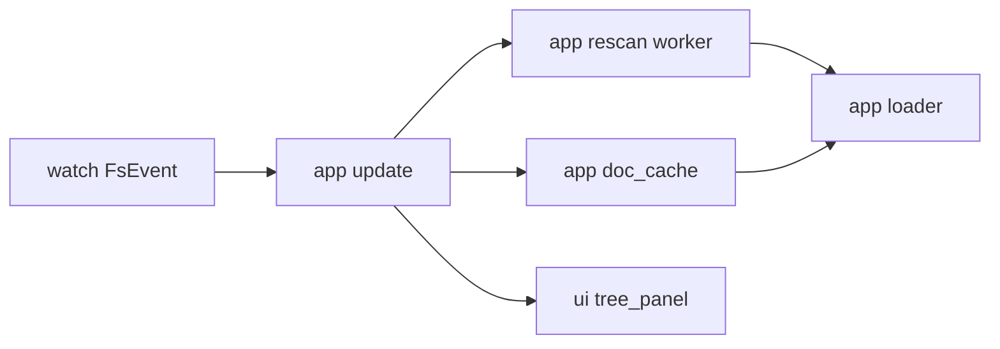

# 설계서 - spec-viewer-refresh-responsiveness

## 정의
스펙 문서를 편집하며 트리와 문서를 보는 spec-viewer 사용자를 위해, 재스캔을 백그라운드로 옮기고 문서 렌더 결과를 재사용하며 보이는 문서 한 개의 변경은 부분 갱신하고 좁은 패널의 날짜를 `MM-DD`로 줄이는 설계이다.

## 경계 확정

### 소유 범위 (이 스펙)
- **백그라운드 재스캔 조정**: 재스캔 요청, 진행 중 합치기, 완료 결과 수령, 오래된 결과 폐기.
- **문서 렌더 캐시**: `(경로, 수정 시각, 크기, 폭)` 키의 작은 LRU.
- **변경 영향 판정**: 변경 경로로 부분 갱신 가능 여부를 정하는 함수.
- **날짜 축약 표시**: 문서 행의 날짜 단계 선택(전체 날짜 및 시각, 날짜, `MM-DD`, 생략).

### 비소유 범위
- **감시기와 디바운스**: `watch`가 소유. 이 스펙은 이벤트를 받는 쪽만 바꾼다.
- **스캔 알고리즘과 정렬**: `FsTree::scan`, `spec::build`, `sort_specs`는 그대로 호출만 한다.
- **시분초 규칙**: `spec-viewer-doc-modified-date`가 소유. 이 스펙은 그 규칙 아래 단계만 추가한다.
- **마크다운 렌더러**: 결과를 캐시만 하고 내부는 건드리지 않는다.

### 허용 의존
- External: 없음(표준 라이브러리 스레드와 채널).
- Internal direction: `app::loader`(읽기) -> `app::rescan`(백그라운드 조정) -> `app`(상태 반영) -> `ui::tree_panel`(표시). `app::doc_cache`는 `loader`만 알고, 선택 경로(`resolve_selection`)가 캐시를 받아 `loader::load_doc` 직접 호출과 `load_for_selection`의 문서 읽기를 캐시 경유로 바꾼다. 역방향 import는 설계 위반이다.

### 재검증 조건
- `AppState.root`를 바꾸는 새 경로가 생길 때(결과 폐기 조건 재확인).
- 문서 렌더 입력이 파일 외 요소(테마 등)로 늘 때(캐시 키 재확인).
- `watch`가 이벤트 종류(생성, 수정, 삭제)를 전달하게 될 때(부분 갱신 판정 단순화).

## 아키텍처

### 경계 맵


### 기술 스택
| 계층 | 선택 기술 | 역할 |
|-------|--------|------|
| 백그라운드 | `std::thread`, `std::sync::mpsc` | 재스캔 실행과 결과 전달 |
| 캐시 | 표준 컬렉션(`VecDeque` 기반 LRU) | 렌더 결과 보관 |
| 표시 | ratatui 0.30 | 날짜 단계별 구간 |

### 핵심 결정
- **재스캔은 요청 스냅숏을 가진 단발 스레드로 한다**: 요청 때 소스 종류, 뿌리, 정렬 키를 복사해 스레드에 넘기고 결과를 채널로 받는다 - reason: 상태 공유 없이 데이터 경합이 없다. 대안(상주 워커 스레드)은 단순함에서 밀려 기각.
- **완료 반영은 이벤트 루프가 폴링한다**: 기존 100ms 입력 폴링 주기에 결과 확인을 끼운다 - reason: 루프 구조 변경 최소.
- **결과에 세대 번호를 붙인다**: 소스 전환이나 뿌리 변경 때 세대를 올리고 다른 세대 결과는 버린다 - reason: 1.5.
- **동기 방식 유지**: `AppState.rescan_mode`가 `Sync`(기본, 테스트)면 지금처럼 즉시 재스캔, `Background`(main이 설정)면 위 방식 - reason: 5.2, 기존 테스트 보존.
- **캐시 키에 크기와 수정 시각을 함께 쓴다**: 같은 초 안의 편집을 놓치지 않으려는 안전장치 - reason: 2.2. 확인용 stat은 읽기+렌더보다 훨씬 싸다.
- **부분 갱신은 보수적으로**: 열린 문서 한 개의 일반 문서만 대상으로 하고 `spec.json`과 `tasks.md`(배지와 진행률에 영향)는 전체 재스캔 - reason: 3.2. 오판 시 배지가 낡는 위험을 피한다.
- **렌더 결과는 복제 가능하게 한다**: `Rendered`, `Footnote`, `HeadingAnchor`, `FileInfo`, `DocView`에 `Clone`을 파생한다 - reason: 캐시가 hit 때 사본을 돌려준다. 깊은 복제는 재읽기와 재렌더보다 훨씬 싸다(메모리 복사). 대안(`Rc` 공유)은 `DocView` 사용처 전반을 바꿔야 해 기각.
- **세대가 바뀌면 대기 요청을 버리고 새 요청은 곧바로 시작한다**: 옛 스레드는 결과가 버려질 뿐 계속 돌 수 있다 - reason: 새 뿌리 갱신 지연 방지. 동시 한 개 규칙은 현재 세대에만 적용.
- **정렬은 반영 시점에 다시 적용한다**: 스레드는 요청 시점 정렬로 결과를 만들되, 반영 직전에 현재 정렬 키로 다시 정렬한다(spec-kit은 정렬 없음) - reason: 1.8.
- **부분 갱신은 `Action::Fs`만 대상이다**: `Refresh`와 빈 경로 이벤트는 항상 전체 재스캔 - reason: 3.2.
- **날짜 단계는 위에서부터 첫 적합 단계를 택한다**: 시각 포함 날짜, 날짜, `MM-DD`, 생략 - reason: 4.x, 문서명과 진행률 우선.

## 요구사항 추적
| 요구사항 ID | 구현 요소 |
|---|---|
| 1.1~1.7 | 재스캔 조정, 상태 반영 |
| 2.1~2.5 | 문서 렌더 캐시 |
| 3.1~3.3 | 변경 영향 판정, 상태 반영 |
| 4.1~4.4 | 날짜 단계 선택 |
| 5.1, 5.2 | 재스캔 방식 전환(Sync 기본), 모든 경로 읽기 전용 |

## 컴포넌트와 인터페이스

### app::rescan - 백그라운드 재스캔 조정
- 의도: 재스캔 요청 합치기, 스레드 실행, 완료 수령, 오래된 결과 폐기.
- 요구사항: 1.1, 1.4, 1.5, 1.7
```rust
pub struct RescanCoordinator { /* 세대, 진행 중 여부, 대기 중 요청, 수신기 */ }
pub struct RescanRequest { pub kind: TreeSourceKind, pub root: PathBuf, pub sort_key: SortKey }
impl RescanCoordinator {
    pub fn request(&mut self, req: RescanRequest);          // 진행 중이면 대기 표시만
    pub fn invalidate(&mut self);                           // 세대 증가(소스 전환, 뿌리 변경)
    pub fn poll(&mut self) -> Option<TreeSource>;           // 현재 세대의 완료 결과만
}
```
- 스레드가 패닉하거나 채널이 끊기면 결과 없음으로 처리하고 진행 중 표시를 해제한다(1.7).

### app - 상태 반영
- 의도: `Action::Fs`/`Refresh`에서 방식에 따라 동기 `resync` 또는 요청, 폴링된 결과를 반영.
- 요구사항: 1.2, 1.3, 1.6, 3.1~3.3, 5.2
```rust
pub enum RescanMode { Sync, Background }   // AppState.rescan_mode, 기본 Sync
pub fn apply_rescan_result(state: &mut AppState, tree: TreeSource);   // 정렬 재적용 + 열린 문서 갱신
pub fn is_partial_refresh_target(state: &AppState, paths: &[PathBuf]) -> Option<PathBuf>;
```
- `apply_rescan_result`는 현재 정렬 키로 다시 정렬한 뒤 기존 `resync`의 `refresh_current_doc`를 공유한다(SSoT).
- 부분 갱신은 `Action::Fs`에서만 판정한다. 대상이면 `reload_current_doc` 경로로 최신을 읽고(캐시를 거치지 않음), 소스별로 해당 `DocEntry.modified`(`.kiro`, spec-kit) 또는 `FsEntry.modified`(파일 모드)를 직접 패치한다.
- 루프는 입력 폴링이 타임아웃으로 끝난 경우에도 완료 결과를 확인하고, 결과가 있을 때만 다시 그린다(유휴 재그리기 금지).

### app::doc_cache - 문서 렌더 캐시
- 의도: 같은 문서의 재선택에서 읽기와 렌더를 건너뛴다.
- 요구사항: 2.1~2.5
```rust
pub struct DocCache { /* 상한 16, 사용 순서 */ }
impl DocCache {
    pub fn load(&mut self, path: &Path, width: u16) -> DocView;   // stat 후 키 일치 시 사본, 아니면 loader::load_doc
}
```
- 파일이 없거나 읽기 실패는 캐시하지 않는다(2.3).

### ui::tree_panel - 날짜 단계 선택
- 의도: 행 너비와 패널 폭으로 날짜 단계를 정한다.
- 요구사항: 4.1~4.4
```rust
enum DateStage { DateTime, Date, MonthDay, Hidden }
fn pick_date_stage(row_width_without_date: usize, panel_width: u16) -> DateStage;
```
- `MM-DD` 문자열은 `app::loader`의 `format_modified_date`에서 파생하는 함수로 만든다(SSoT).
- 단계별 너비: 시각 포함 `2 + 19`, 날짜 `2 + 10`, `MM-DD` `2 + 5`칸. 크롬 6칸은 기존 상수를 쓴다.

## 데이터 모델
위 인터페이스 블록이 전부다. 새 영속 데이터는 없다.

## 오류 처리
- **사용자 입력 오류**: 해당 없음.
- **외부 자원 오류**: 스캔 중 읽기 실패는 기존 스캔의 처리를 따른다. 스레드 실패는 기존 트리 유지(1.7).
- **시스템 오류**: 스레드 생성 실패 시 동기 재스캔으로 대체한다(단위 테스트로 검증).
- **기능 강등**: 캐시 miss는 지금과 같은 동작이다.

## 테스트 전략
- **깊이**: Standard - 동시성 경계가 있지만 데이터 공유가 없고 규칙은 단순하다.
- **단위**: 재스캔 합치기(여러 요청이 한 번 추가 실행), 세대 폐기, 스레드 실패 복구(1.4, 1.5, 1.7). 캐시 hit, miss(시각, 크기, 폭 변경), 삭제, LRU 상한(2.x). 부분 갱신 판정의 허용과 거부 경로(3.1, 3.2). 날짜 단계 경계 폭(4.x).
- **통합**: 백그라운드 모드에서 `Action::Fs` 후 입력이 즉시 처리되고 완료 시 트리가 갱신됨. 정렬, 선택, 삭제 표시 보존(1.3, 1.6).
- **E2E**: 실제 실행에서 큰 디렉터리 파일 모드에서 새로고침 중에도 키 입력에 반응(1.2).
- **인수**: 1.1~5.2 충족과 실제 실행 확인.
- **성능**: 재스캔 중 입력 처리 지연을 `Instant`가 아닌 "입력 처리 시점에 재스캔 미완료 상태" 카운터 검증으로 확인한다(타이밍 비의존, 불안정 테스트 방지).
- **속성 기반**: P1: 임의의 요청 시퀀스에서 동시에 진행 중인 재스캔은 최대 1개 - 1.4 - 요청 횟수 0 이상. 스티어링에 라이브러리 지정이 없어 대표 시퀀스 예시로 검증한다.

## 파일 구조 계획
```
src/app/rescan.rs       code  RescanCoordinator, RescanRequest + 테스트
src/app/doc_cache.rs    code  DocCache + 테스트
src/app/mod.rs          code  rescan_mode, 결과 반영, 부분 갱신 판정, Fs/Refresh 분기
src/main.rs             code  Background 설정, 루프에서 poll, 소스 전환 때 invalidate
src/markdown/mod.rs     code  Rendered, Footnote, HeadingAnchor에 Clone 파생
src/app/loader.rs       code  MM-DD 파생 함수, 선택 경로의 문서 읽기를 캐시 경유로
src/ui/tree_panel.rs    code  DateStage 선택 + 테스트
```
