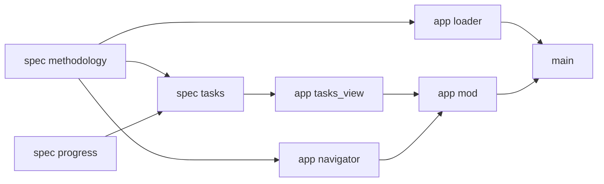
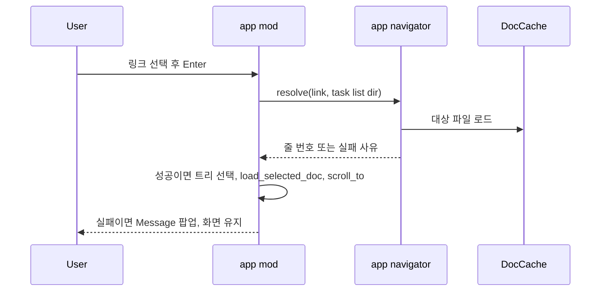

# 설계서 - spec-viewer-tasks-view

## 정의
스펙 작업을 진행하거나 리뷰하는 개발자를 위해, 방법론 설정이 지정한 작업 목록 문서를 구조화된 뷰로 보여주고 메타 태그에서 같은 디렉터리의 참조 위치로 이동시키는 기존 `app`/`spec` 모듈 확장 설계이다.

## 설계 보정 (2026-10-02 요구사항 대비 현재 코드, v0.13.1)
- **렌더 캐시와 재스캔 경로 증가**: 문서 설치 지점이 5곳(`show_selected_doc`, `load_selected_doc`, `refresh_current_doc`, `refresh_open_doc_only`, `resize_and_preserve_position`)으로 늘었다. 각 곳에서 뷰를 따로 고르면 어긋나므로 설치를 `install_doc` 한 곳으로 모으고 그 안에서만 Tasks 뷰로 치환한다. `DocCache`는 마크다운 렌더만 담고 바뀌지 않는다.
- **번호 탐색 대상은 원문이 아니라 렌더된 줄**: brief는 원문 텍스트 탐색이라 했으나 이동 좌표는 `Rendered.plain`의 줄 번호이고, 원문 줄과 렌더 줄 사이 대응표는 없다(줄바꿈, 펜스 렌더). 그래서 같은 문자열 규칙을 `plain` 줄에 적용한다. 형식별 파서를 쓰지 않으므로 5.5는 그대로 성립한다.
- **`tasks.md`가 `FULL_RESCAN_FILE_NAMES`에 고정**: 편집은 항상 전체 재스캔 후 `refresh_current_doc`를 거친다. `install_doc`가 그 경로를 덮으므로 추가 조치가 없다. 다만 작업 목록 파일명을 설정으로 바꾸면 진행률 배지(`DocKind::Tasks`)와 전체 재스캔 목록은 여전히 `tasks.md`에 고정이다(6.3 때문에 유지, 후속 과제).
- **`Rendered`에 변경 없음**: 링크 위치는 `Rendered`에 넣지 않고 `TasksView`가 따로 갖는다. `Rendered` 생성처가 테스트까지 100곳 넘어 필드 추가는 비용이 크다. 링크 선택 강조는 선택 링크를 `SpanStyle::Raw` 반전으로 구워 다시 렌더하므로 `ui::doc_panel`은 바뀌지 않는다.
- **파일 모드 접점**: `FsTree::node_path_for`(cursor-scan 스펙이 작업 중)는 Files 전용이라 쓰지 않는다. `.kiro`/spec-kit용 문서 노드 경로 계산을 `spec`에 새로 둔다.
- **설정 인프라 없음 재확인**: `.kiro/settings/`에는 `templates`만 있고 설정 파일 읽기는 없다. 읽기만 하는 JSON 한 개를 `app::loader`에 추가한다(`serde_json` 기존 의존).

## 경계 확정

### 소유 범위 (이 스펙)
- **방법론 설정 모델**: 작업 목록 파일명, 태그별 이름 별칭과 링크 규칙(대상 파일, 탐색 방식, 값 분리)과 `.kiro` 기본값, JSON 덮어쓰기 병합.
- **작업 목록 파서**: 작업 목록 원문 -> 작업 번호, 체크 상태, `(P)`, 제목, 메타 태그의 구조 모델.
- **Tasks 뷰 렌더**: 모델 -> `Rendered`와 링크 목록, 링크 커서.
- **Navigator**: 링크 값 -> 대상 파일 선택 -> 렌더된 줄에서 위치 탐색 -> 트리 선택 갱신과 스크롤.
- **뷰 전환 상태**: 전환 키, 링크 이동 키, `install_doc` 치환 지점.

### 비소유 범위
- **마크다운 렌더와 문서 캐시**: `markdown::render_for_display`, `DocCache`는 호출만 한다.
- **진행률 집계와 배지**: `spec::progress::count_progress` 결과와 표시는 그대로 둔다(체크박스 인식 규칙만 공유).
- **문서 내 검색, TOC, 선택 복사**: `Rendered`를 입력으로 하므로 그대로 동작한다.
- **트리 구성과 감시**: `spec::build`, `watch`는 바꾸지 않는다.
- **biz-process.md 형식 결정**: 형식 조정은 `agentic-psdd`가 소유한다.

### 허용 의존
- External: 신규 없음(`serde`, `serde_json`, `ratatui`, `tui-tree-widget` 기존 버전).
- Internal direction: `spec::{methodology, tasks, progress}` -> `app::{loader, tasks_view, navigator}` -> `app::mod`(reducer) -> `main`. `ui`는 `app`만 읽고 이 스펙에서 바뀌지 않는다(역방향 import는 설계 위반).

### 재검증 조건
- `Rendered`에 줄별 링크 정보를 넣게 될 때(링크 보관 위치 전제).
- 방법론이 `_Name: value_` 태그 표기를 바꿀 때(파서 전제).
- 설정이 spec-kit 등 다른 소스 종류까지 열릴 때(소스 종류별 설정 선택 전제).
- 문서 설치 지점이 `install_doc` 밖에 새로 생길 때.

## 아키텍처

### 경계 맵


### 기술 스택
| 계층 | 선택 기술 | 역할 |
|---|---|---|
| 설정 | serde_json 1 | `.kiro/settings/spec-viewer.json` 읽기 |
| 뷰 | markdown::{Rendered, Line, Span} (기존) | 구조화 뷰를 기존 `Rendered`로 생산 |
| 상태 | app::AppState (기존) | 전환 플래그, 링크 커서 |

### 핵심 결정
- **`Rendered`로 치환**: 구조화 뷰도 `DocView::Rendered`로 만든다 - 스크롤, 검색, TOC, 상태바, 선택 복사가 그대로 동작해 6.5가 공짜다. 별도 `DocView` 변형은 104곳 매칭을 건드린다.
- **치환 지점 단일화**: `install_doc(state, view)` - 5개 설치 지점이 같은 규칙을 쓴다. 대안은 research.md.
- **작업 목록 판정**: 소스가 `.kiro`이고, 열린 문서 파일명이 설정의 작업 목록 파일명이며, 그 부모가 `SpecRoot.specs[*].dir` 중 하나일 때만 - `--all`, spec-kit, steering 그룹의 같은 이름 파일은 자연히 제외된다(6.4).
- **링크는 값 모양이 맞을 때만**: 번호 규칙 태그는 값이 번호 모양(`1.1`, `2.1~2.5`)일 때만 링크가 된다 - `_Boundary: app::mod_` 같은 컴포넌트 이름은 평범한 텍스트로 남는다(조용한 실패, brief 목표).
- **설정은 `.kiro` 소스 전용**: `AppState.methodology`는 Kiro 소스일 때만 `Some`, 소스 전환 때 다시 계산한다. 설정 파일 변경은 재시작 후 반영한다.
- **링크 조작은 키보드만**: 마우스 클릭은 기존 선택 복사와 충돌하므로 범위 밖이다.

## 시스템 흐름

- 같은 문서 대상(`_Depends:_`)은 캐시 로드 없이 현재 구조화 뷰의 `plain`에서 찾고 스크롤만 한다 (3.2).
- 전부 성공해야 상태를 바꾼다: 대상 로드와 위치 탐색과 트리 경로 확인이 끝난 뒤에만 선택과 문서를 갱신한다 (4.1, 4.2).

## 요구사항 추적
| 요구사항 ID | 구현 요소 |
|---|---|
| 1.1, 1.5 | `spec::tasks::parse_tasks`, `app::tasks_view::render_tasks_view`(작업 0개이면 안내 줄) |
| 1.2, 1.3, 1.4 | `app::mod::toggle_tasks_view`, 전환 키 `v` |
| 2.1~2.3 | `render_tasks_view`(태그 서브라인, `(P)` 표식), `parse_tasks`(별칭 DONE) |
| 3.1~3.3 | `app::navigator::resolve_link`, `locate_line` |
| 3.4 | `spec::locate_doc_node` + `load_selected_doc` 재사용 |
| 4.1, 4.2 | `NavigationError` + 상태 불변 보장 |
| 5.1~5.4 | `spec::methodology`(모델, 기본값, 병합), `app::loader::load_methodology_settings` |
| 5.5 | `locate_line`이 `plain` 줄 문자열 규칙만 사용(형식별 파서 없음) |
| 6.1~6.4 | `install_doc`의 판정 분기, 진행률 코드 비수정 |
| 6.5 | `Rendered` 치환(검색 코드 비수정) |

## 컴포넌트와 인터페이스

### spec - methodology
- 의도: "어떤 파일이 작업 목록이고 어떤 태그가 어디로 이어지는가"를 선언하는 읽기 전용 모델. 파싱 로직 없음.
- 요구사항: 5.1~5.4
```rust
pub struct MethodologySettings { pub task_list_file: String, pub tags: Vec<TagRule> }
pub struct TagRule { pub name: String, pub aliases: Vec<String>, pub link: Option<LinkRule> }
pub struct LinkRule { pub targets: Vec<LinkTarget>, pub locate: LocateBy, pub values: ValueSplit }
pub enum LinkTarget { SameFile, File(String) }
pub enum LocateBy { LeadingNumber, TitleText }
pub enum ValueSplit { CommaList, Whole }
impl MethodologySettings {
    pub fn kiro_default() -> Self;
    pub fn parse_overrides(json: &str) -> Result<Self, SettingsError>;
    pub fn rule_for(&self, tag_name: &str) -> Option<&TagRule>;
}
```
- 기본값: 작업 목록 `tasks.md`; `Requirements`, `Boundary` -> `requirements.md`, `bugfix.md`(앞에서부터 존재하는 첫 파일) + `LeadingNumber` + `CommaList`; `Depends` -> `SameFile` + `LeadingNumber` + `CommaList`; `BizProcess` -> `biz-process.md` + `TitleText` + `Whole`; `DoneWhen`(별칭 `DONE`), `Difficulty`, `Verify` 링크 없음.
- 병합: 파일의 `tags` 항목은 같은 이름의 기본 항목을 통째로 대체하고 새 이름은 추가한다. `"link": null`은 링크 해제. 없는 항목은 기본값(5.4).

### spec - tasks
- 의도: 작업 목록 원문을 구조 모델로 바꾼다(신규 파서는 이 파일만). 체크박스 인식은 `progress`와 공유한다.
- 요구사항: 1.1, 1.5, 2.1~2.3
```rust
pub struct TasksDocument { pub blocks: Vec<TasksBlock> }
pub enum TasksBlock { Heading { level: u8, text: String }, Text(String), Task(TaskItem) }
pub struct TaskItem { pub number: Option<String>, pub state: TaskState, pub is_parallel: bool,
    pub title: String, pub tags: Vec<TaskTag>, pub notes: Vec<String> }
pub enum TaskState { Done, Open, OptionalOpen }
pub struct TaskTag { pub name: String, pub value: String }
pub fn parse_tasks(source: &str, settings: &MethodologySettings) -> TasksDocument;
```
- 규칙: 체크박스 줄이 작업을 연다. 뒤따르는 들여쓴 줄이 `_Name: value_` 모양이거나 설정 이름/별칭으로 시작하는 `DONE: ...` 모양이면 태그(별칭은 정식 이름으로 정규화), 아니면 `notes`. 들여쓰지 않은 비체크박스 줄은 작업을 닫고 제목이나 본문 블록이 된다. 패닉 없음, 빈 입력은 빈 문서.

### spec - progress (수정)
- 의도: 체크박스 인식 규칙을 `parse_checkbox_marker`로 꺼내 `count_progress`와 `parse_tasks`가 공유한다(SSoT). 집계 결과는 그대로다.
- 요구사항: 6.3
```rust
pub(crate) fn parse_checkbox_marker(line: &str) -> Option<(TaskState, &str)>;
```

### spec - locate_doc_node
- 의도: 파일 경로로 `.kiro`/spec-kit 트리의 문서 노드 경로(`[Spec, Doc]`)를 구한다. 설정의 파일명이 `DocKind`를 몰라도 되도록 `Spec.docs`의 경로로 찾는다.
- 요구사항: 3.4
```rust
pub fn locate_doc_node(root: &TreeSource, file: &Path) -> Option<Vec<NodeId>>;
```

### app - loader (수정)
- 의도: `<kiro_root>/settings/spec-viewer.json`을 읽어 설정을 만든다.
- 요구사항: 5.2~5.4
```rust
pub fn load_methodology_settings(kiro_root: &Path) -> (MethodologySettings, Option<String>);
```
- 파일 없음은 기본값에 경고 없음, 읽기나 파싱 오류는 기본값에 경고 문자열.

### app - tasks_view
- 의도: `TasksDocument`를 `Rendered`와 링크 목록으로 만들고 링크 커서를 관리한다.
- 요구사항: 1.1, 1.5, 2.1~2.3
```rust
pub struct TasksView { pub links: Vec<TaskLink>, pub selected_link: Option<usize>, document: TasksDocument }
pub struct TaskLink { pub tag_name: String, pub value: String, pub line: usize }
impl TasksView {
    pub fn build(document: TasksDocument, settings: &MethodologySettings) -> Self;
    pub fn render(&self, width: u16) -> Rendered;
    pub fn select_next_link(&mut self, from_line: usize) -> Option<usize>;
    pub fn select_previous_link(&mut self, from_line: usize) -> Option<usize>;
}
```
- 화면: 작업 줄은 `[x]`/`[ ]` 상태와 번호, `(P)` 표식(병렬 가능 표시 문구), 제목. 태그는 들여쓴 서브라인에 이름과 값으로 구분해 보이고 링크 값은 `SpanStyle::Link`, 선택 링크는 반전. 메이저 작업은 `HeadingAnchor`로 등록해 `[`/`]`가 작업 단위로 이동한다. 폭에 맞춰 `markdown::wrap`으로 줄바꿈하고 링크 값은 쪼개지 않는다. 작업이 0개이면 제목과 본문 블록 뒤에 안내 줄 하나.

### app - navigator
- 의도: 링크 한 개를 대상 파일과 줄로 해석한다. 상태는 바꾸지 않는 순수 해석.
- 요구사항: 3.1~3.3, 4.1, 4.2, 5.5
- 업무 규칙: BR-NAV-1 번호 탐색은 줄 앞의 비영숫자 장식(글머리표, 체크박스, `#`)을 건너뛰고 번호가 오며 그 뒤에 숫자나 `.숫자`가 오지 않을 때만 일치한다(`3`이 `3.1` 줄에 일치하지 않음). BR-NAV-2 제목 탐색은 `headings` 텍스트를 먼저, 없으면 `plain` 줄 전체에서 부분 문자열을 찾는다. BR-NAV-3 범위 값(`2.1~2.5`)은 시작 번호로 간다.
```rust
pub enum NavigationError { TargetFileMissing(Vec<String>), TargetUnreadable(PathBuf), ReferenceNotFound(String) }
pub struct NavigationTarget { pub file: PathBuf, pub is_same_file: bool }
pub fn resolve_target_file(rule: &LinkRule, task_list: &Path) -> Result<NavigationTarget, NavigationError>;
pub fn locate_line(rendered: &Rendered, locate: LocateBy, value: &str) -> Result<usize, NavigationError>;
pub fn link_values(rule: &LinkRule, raw_value: &str) -> Vec<String>;
```

### app - mod (리듀서 수정)
- 의도: 상태 필드와 `install_doc`, 전환 키, 링크 키를 얹는다.
- 요구사항: 1.2~1.4, 3.4, 6.1~6.5
```rust
// AppState 추가: methodology: Option<MethodologySettings>, tasks_view: Option<TasksView>, is_tasks_view_enabled: bool (기본 true)
fn install_doc(state: &mut AppState, view: DocView);
fn is_task_list_doc(state: &AppState) -> bool;
fn toggle_tasks_view(state: &mut AppState);
fn follow_selected_link(state: &mut AppState);
```
- 키: `v` 전환, `l`/`L` 다음/이전 링크, 문서 포커스에서 링크가 선택돼 있으면 `Enter`가 이동(아니면 기존 `select`). 모두 `keymap::BINDINGS` 한 표에 추가해 도움말이 자동 갱신된다.
- 계약: `install_doc`는 작업 목록 문서가 아니거나 전환 꺼짐이면 `state.doc = view`와 동일하다. 이동 실패는 `Popup::Message`이고 선택, 문서, 스크롤은 그대로다. 성공 경로는 `tree.select` 후 `load_selected_doc`(포커스와 단일 모드 규칙 포함) 후 `scroll_to`로 기존 흐름을 재사용한다.

### main - 배선
- 의도: 시작과 `ApplySourceSwitch` 때 Kiro 소스이면 설정을 읽어 `AppState.methodology`에 넣고 경고가 있으면 메시지 팝업으로 알린다.
- 요구사항: 5.2~5.4

## 데이터 모델
위 인터페이스 블록이 전부다. 불변식: `TaskLink.line`은 렌더 결과의 `plain` 인덱스이고 렌더마다 다시 계산한다. 링크 커서는 재렌더(재스캔, 리사이즈, 전환)에서 초기화된다.

## 오류 처리
- **사용자 입력 오류**: 이동 대상 파일 없음, 번호나 제목 없음, 노드가 트리에 없음은 `Popup::Message`로 알리고 상태 불변 (4.1, 4.2). 전환 키는 작업 목록 문서가 아니면 무동작 (1.4).
- **외부 자원 오류**: 설정 파일 읽기/파싱 실패는 기본값으로 동작하고 경고 팝업 (5.4). 작업 목록 재읽기 실패는 마크다운 렌더 그대로 둔다.
- **시스템 오류**: 파서와 탐색은 슬라이스 인덱싱을 경계 검사 후에만 한다. 패닉 경로 없음.
- **기능 강등**: 체크박스 없는 작업 목록은 안내 줄 (1.5). 값 모양이 맞지 않는 태그는 링크 없이 텍스트.

## 테스트 전략
- **깊이**: Complex - 파서, 탐색 규칙, 상태 불변 계약이 있고 화면 출력이 산출물이다.
- **단위**: `parse_tasks`(번호, 상태 3종, `(P)`, 별칭 `DONE`, 들여쓰기 없는 줄, 빈 입력, 체크박스 0개) 1.1, 1.5, 2.3. `parse_overrides` 병합과 5.4 기본값 (5.1~5.4). `locate_line`(BR-NAV-1~3, 구형 ID와 제목 형식 모두) 3.1~3.3, 5.5. `parse_checkbox_marker`가 `count_progress` 기존 테스트 전부를 통과 (6.3).
- **통합**: 실제 `Rendered` 버퍼 단언 - 작업 줄, 태그 서브라인, `(P)` 표식이 프레임에 보이는 것 (1.1, 2.1, 2.2). `follow_selected_link` 성공 3종과 실패 2종 후 `state.tree.selected()`와 `state.doc` 일치 (3.4, 4.1, 4.2). 같은 소스의 `.kiro` 외 문서와 `--all`/spec-kit이 기존 렌더와 동일 (6.2, 6.4). 전환 왕복 (1.2, 1.3). 검색이 구조화 뷰에서 일치 줄을 찾음 (6.5).
- **E2E**: biz-process L2 흐름 세 개를 실제 터미널(pty)로 - 열기와 전환, 태그 이동, 설정 덮어쓰기.
- **인수**: 요구사항 1~6 전부 충족과 이 저장소의 실제 스펙 폴더 실행.
- **속성 기반**: 저장소는 `Cargo.toml`에 속성 테스트 라이브러리가 없고 steering `tech.md`도 없다. 의존을 추가하지 않고 시드 고정 난수 생성기로 반복하는 테스트로 구현한다(실패 시 시드와 입력 출력).
  - P1: 임의 텍스트에서 `parse_tasks`는 패닉하지 않고 작업 수가 `count_progress`의 total과 같다 - 1.1, 1.5, 6.3 - 임의 줄 조합.
  - P2: 번호 N에 대해 `locate_line`은 N 뒤에 숫자 또는 `.숫자`가 이어지는 줄에 절대 일치하지 않는다 - 3.1, 3.2 - 임의 번호와 줄.
  - P3: 작업 목록 문서가 아니면 `install_doc`은 `state.doc = view`와 동일하다 - 6.2, 6.4 - 임의 경로와 소스 종류.
  - P4: 이동이 실패하면 `tree.selected()`, `doc` 경로, `scroll`이 호출 전과 같다 - 4.1, 4.2 - 임의 링크 값.
- **성능**: 작업 수백 개 문서의 재렌더가 한 프레임 안에 끝나는지 한 번 확인한다(링크 이동마다 재렌더하므로).

## 파일 구조 계획
```
src/spec/methodology.rs   설정 모델, 기본값, 병합 (code)
src/spec/tasks.rs         작업 목록 파서 (code)
src/spec/progress.rs      체크박스 인식 공유 함수 추출 (code, 수정)
src/spec/mod.rs           locate_doc_node, 모듈 선언 (code, 수정)
src/app/tasks_view.rs     구조화 뷰 렌더, 링크 커서 (code)
src/app/navigator.rs      링크 해석, 줄 탐색 (code)
src/app/loader.rs         설정 파일 읽기 (code, 수정)
src/app/mod.rs            상태 필드, install_doc, 키 처리 (code, 수정)
src/app/keymap.rs         v, l, L 바인딩 (code, 수정)
src/main.rs               설정 읽기 배선 (code, 수정)
tests/fixtures/kiro-tasks-view/specs/tasks-view-sample/  요구사항, 업무프로세스, 작업 목록 샘플 (data)
```
