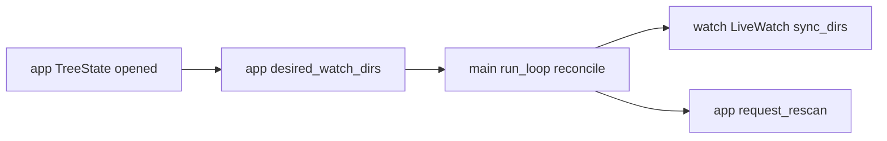

# 설계서 - spec-viewer-watch-opened-dirs

## 정의
큰 작업 폴더를 파일 모드로 여는 사용자를 위해, 파일 감시기를 재귀 한 개에서 "열린 폴더별 비재귀 감시"로 바꾸고 펼침 상태와 동기화하는 설계이다.

## 경계 확정

### 소유 범위 (이 스펙)
- **감시 범위 정책**: 소스 종류별 범위(재귀 루트 vs 열린 폴더 집합).
- **감시 집합 동기화**: 원하는 폴더 집합과 현재 감시 집합의 차이를 감시기에 반영.
- **원하는 폴더 집합 계산**: 스캔 루트, 펼친 폴더, 열린 문서의 폴더.
- **따라잡기 요청**: 새로 감시한 폴더가 있을 때 재스캔 한 번 요청.

### 비소유 범위
- **스캔과 재스캔 실행**: `FsTree::scan`, `RescanCoordinator`는 호출만 한다.
- **트리 펼침 상태 자체**: `TreeState`가 소유, 읽기만 한다.
- **디바운스와 이벤트 경로 변환**: `watch::start_with_cache`의 기존 방식을 유지한다.

### 허용 의존
- Internal direction: `app`(원하는 집합 계산, 읽기 전용) -> `main`(루프 접착, 집합 비교) -> `watch`(감시기 조작). `watch`는 `app`을 모른다(경로 집합만 받는다).

### 재검증 조건
- 폴더를 펼치는 새 경로가 `TreeState` 밖에서 생길 때.
- Files 모드가 지연 로딩 스캔으로 바뀔 때(따라잡기 재스캔 전제 재확인).
- 폴더 펼침이 잦아 따라잡기 재스캔이 연달아 도는 것이 관측될 때(스캔 빈도 재확인).

## 아키텍처

### 경계 맵

### 핵심 결정
- **`Watch::Live`를 `LiveWatch` 래퍼로 바꾼다**: 디바운서, 범위(`Recursive` | `OpenedDirs`), 현재 감시 폴더 집합을 가진다. `Watch::Live(_)` 패턴 매칭 사용처는 그대로 유효하다 - reason: 기존 호출부와 테스트 변경 최소. (1.1, 1.2, 5.1)
- **시작 함수는 기존 `start(root, tx)`(= `Recursive`)를 유지하고 `start_scoped(root, tx, scope)`를 추가한다**: `OpenedDirs`는 루트 한 개를 `NonRecursive`로 등록해 비용이 폴더 총수와 무관하다. `start_with_cache`는 `LiveWatch`를 만들어 돌려주도록 반환 타입을 조정한다 - reason: 기존 호출부와 테스트 보존. (1.1, 1.2, 5.2, 5.3)
- **`LiveWatch::sync_dirs(&mut self, desired) -> usize`**: 입력 경로를 `start`와 같은 canonicalize 함수(SSoT) 한 곳으로 정규화해 정규화된 키로 현재 집합과 비교한다(상대 경로 루트와 심볼릭 링크 루트에서도 루트가 새 폴더로 오판되지 않음). 빠진 폴더는 `unwatch`(실패 무시), 현재 집합 중 디스크에서 사라진 폴더는 집합에서 제거(감시기가 자동 해제하므로, 재생성 시 다시 등록되게 함), 새 폴더는 `watch(NonRecursive)`이며 실패하면 집합에 넣지 않아 다음 호출에서 재시도한다. 새로 등록한 수를 돌려주고 `Recursive` 범위에서는 no-op이다. 감시기 조작 외에 파일시스템을 쓰지 않는다. (2.1, 2.2, 2.6, 5.4)
- **원하는 집합은 `app::desired_watch_dirs(&AppState) -> BTreeSet<PathBuf>`(읽기 전용)**: `TreeSource::Files`일 때만 계산하고 그 밖의 소스는 빈 집합이다. 구성은 스캔 루트 + `tree.opened()` 중 마지막 노드가 `NodeId::Dir`이고 경로의 모든 접두가 `opened`에 있는 것 + 열린 문서(`DocView::Rendered`의 경로)의 부모 폴더이다. 접힌 부모의 자식 id가 `opened`에 남는 `TreeState` 특성 때문에 접두 검사가 필요하다. `NodeId::Dir`의 경로는 스캔 루트 접두를 그대로 따르므로 절대 경로가 아닐 수 있고, 정규화는 `sync_dirs`가 맡는다. (2.1~2.4, 5.1)
- **동기화 트리거**: `run_loop`의 매 반복(입력 분기 밖)에서 `(opened 집합, 열린 문서 경로)`가 직전과 다르거나, 재스캔 결과가 반영되었거나, `Fs` 이벤트를 처리한 직후면 원하는 집합을 계산해 `sync_dirs`를 호출한다. 변화가 없는 반복은 비교만 한다. 후자 두 조건이 실패한 등록의 재시도와 재생성된 폴더 재등록을 맡는다. 펼침 경로(키, 마우스, 복원, 검색, `ExpandAll`)는 가로채지 않는다. (2.3, 2.4, 2.6)
- **따라잡기**: `sync_dirs`가 1 이상을 돌려주고 기준선 동기화가 아니면 재스캔 한 번을 요청한다. 요청은 `app`이 공개하는 얇은 진입점(`request_rescan` 래퍼)을 쓴다. 여러 폴더가 한 번에 추가돼도 한 번이고 `RescanCoordinator`가 진행 중 요청을 합친다. (3.1)
- **기준선 동기화(재스캔 없음)**: 시작 후 첫 반복과 `handle_switch_mode` 반환 직후에 한 번, 복원된 열린 폴더를 포함해 `sync_dirs`를 호출하되 재스캔은 요청하지 않는다 - reason: 감시는 `AppState` 생성과 위치 복원보다 먼저 시작되어 복원된 폴더가 아직 집합에 없고, 방금 스캔했으므로 따라잡기가 불필요하다. (2.3, 3.2)
- **접힌 폴더의 변경**: 감시하지 않으며 `r`(전체 재스캔)이나 펼침 때의 따라잡기로 반영된다. 감시 중인 폴더의 이벤트 경로는 기존 변환과 `Action::Fs` 처리를 그대로 쓴다. (2.5, 4.1)
- **소스 전환**: `handle_switch_mode`의 새 감시는 소스 종류에 맞는 범위(Files는 `OpenedDirs`, 그 밖은 `Recursive`)로 시작하고 `--no-watch`면 시작하지 않는다. (5.1, 5.2)

## 오류 처리
- 폴더 등록 실패(삭제됨, inotify 한도): 집합에 넣지 않고 건너뛴다. 상태는 `Live`를 유지하고 다음 동기화 트리거에서 재시도한다. 한도 초과가 반복되어도 루트 감시는 유지된다.

## 테스트 전략
- L1 단위(`watch`): `OpenedDirs` 시작 후 루트 직속 변경은 이벤트가 오고 하위 폴더 변경은 오지 않음, `sync_dirs`로 추가한 폴더의 변경은 오고 뺀 폴더의 변경은 오지 않음, 없는 폴더 추가는 오류 없이 건너뜀, 시작 시간이 폴더 수에 비례하지 않음(NoCache 회귀 테스트와 같은 방식, 대량 하위 폴더를 만든 임시 디렉터리).
- L1 단위(`app`): `desired_watch_dirs`가 Files 모드의 루트/펼친 폴더/접힌 조상 아래 폴더 제외/열린 문서 폴더 포함/Kiro 모드 빈 집합을 만족하고, 상대 경로 루트와 심볼릭 링크 루트에서 `sync_dirs`가 루트를 새 폴더로 세지 않으며, 사라졌다 재생성된 폴더가 다시 등록됨.
- L3 통합(`main`): 폴더 펼침 후 동기화가 추가를 돌려주면 재스캔 요청 한 번, 복원된 열린 폴더가 첫 기준선 동기화에서 등록되고 재스캔은 요청되지 않음, 열린 문서만 바뀌어도 동기화가 다시 일어남.
- L5 실제 실행: `~/w`에서 `m` 모드 전환 소요 시간 측정과 tmux 확인(전환 후 폴더를 펼쳐 파일을 만들면 반영됨).
